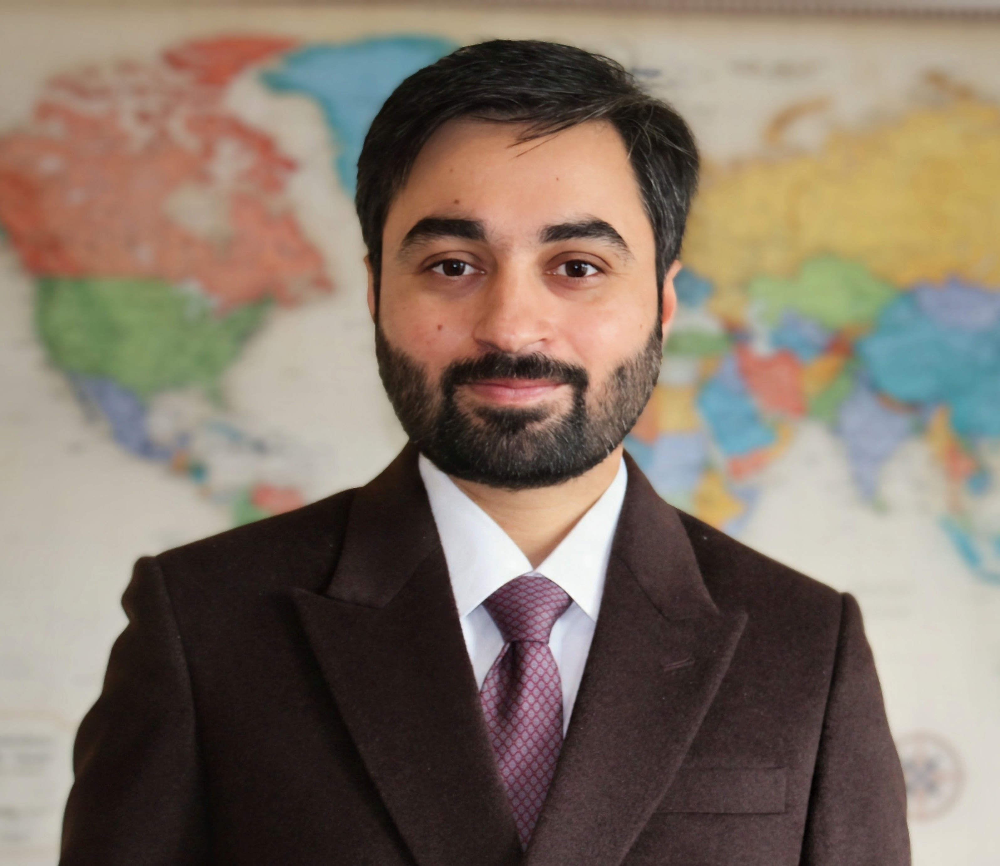

  

  

    

      <strong>Email:</strong> sbanjara@uchicago.edu
    

  

 Welcome! I am a PhD candidate at the University of Chicago's Harris School of Public Policy. I am an economist studying environmental economics, political economy, and the intersection of the two. My research typically involves working with large spatial datasets and applying tools from GIS, remote sensing, and machine learning.
  
  In environmental economics, my research focuses on understanding the value of biodiversity and the efficacy of conservation policies; in political economy, I study the state's role in violence against its citizens; and at the intersection of the two fields, I study the political interactions between the winners and losers of land-use decisions and natural resource extraction.
  
  I have a bachelor's degree in civil engineering from the Institute of Engineering, Pulchowk Campus, and a master's degree in environmental science with a focus on applied remote sensing from the Yale School of the Environment. My research typically involves constructing and analysing large spatial datasets. 

  I am the first person in my extended family to attend and graduate from university, and I benefited greatly from mentors who helped me navigate the academic path. I have tried to pay this forward by offering similar support to students from disadvantaged or nontraditional backgrounds. If you feel talking to me would be helpful, please feel free to reach out—always happy to chat.
